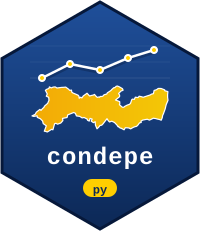

# condepe 

Acesso, pelo Python, aos dados abertos do **Observatório de Pernambuco**,
publicados pela [Condepe/Fidem](https://cf.pe.gov.br) (Agência Estadual de
Planejamento e Pesquisas de Pernambuco): séries municipais de população,
economia, finanças públicas, trabalho, educação, saúde, segurança, transporte e
meio ambiente para os 185 municípios de Pernambuco.

Todas as fontes são publicadas no mesmo formato longo (uma observação por
linha, 15 colunas), e por isso um único conjunto de funções atende a todas,
devolvendo `pandas.DataFrame`.

## Instalação

```bash
pip install condepe
# versão em desenvolvimento:
pip install git+https://github.com/StrategicProjects/condepe-py
```

## Uso

```python
import condepe

# Fontes disponíveis (uma por linha) e a versão do catálogo
cat = condepe.condepe_catalog()
cat.attrs["version"]

# Indicadores de uma fonte
condepe.condepe_indicators("sidra_populacao_estimada")

# Uma série: Recife (IBGE 2611606), de 2020 em diante
condepe.condepe_series(
    "sidra_populacao_estimada",
    "Populacao residente estimada",
    code="2611606",
    years=range(2020, 2027),
)

# Uma fonte inteira e a lista de municípios
condepe.condepe_data("datasus_sinasc")
condepe.condepe_localities()

# Mapas (pip install "condepe[geo]"): malha da Condepe/Fidem ou do IBGE,
# regionalizações do estado e junção dos dados pelo código IBGE
malha = condepe.condepe_geometry(noronha=False)
rd = condepe.condepe_geometry("rd")        # Regiões de Desenvolvimento
condepe.condepe_regions("regiao_saude")    # a que região pertence cada município
mapa = condepe.condepe_add_geometry(condepe.condepe_series(
    "sidra_populacao_estimada", "Populacao residente estimada", years=2025))
```

Os nomes das colunas ficam em português, como publicados, para que todo
resultado possa ser rastreado até os arquivos oficiais: `cd_municipio_ibge`,
`nm_municipio`, `ano`, `mes`, `indicador`, `indicador_base`, `valor`,
`unidade`, `natureza`, `id_fonte`, `eixo`, `tema`, `assunto`, `fonte_original`,
`arquivo_origem`. Séries mensais trazem o período em `indicador`
(`"… [MM/AAAA]"`) e em `mes`; `indicador_base` é o rótulo sem ele.

Documentação: <https://strategicprojects.github.io/condepe-py/> — primeiros
passos, exemplos, mapas e a relação das fontes.

## De onde vêm os dados

- **Canônico:** <https://cf.pe.gov.br/observatorio/dados/atual/>
- **Espelho (reserva):** o dataset do Hugging Face
  [`mlkwy/observatorio-pernambuco`](https://huggingface.co/datasets/mlkwy/observatorio-pernambuco),
  com os mesmos caminhos.

Os arquivos ficam em cache em disco por versão do catálogo
(`condepe_cache_dir()`) e são conferidos pelo SHA-256 publicado no catálogo; o
catálogo vale por 6 horas. As variáveis `CONDEPE_URL`, `CONDEPE_MIRROR_URL` e
`CONDEPE_CACHE_DIR` substituem os padrões.

## Fontes, citação e licença

Os números **não são produzidos pela Condepe/Fidem**: cada série vem de uma
fonte pública oficial (IBGE, Ministério da Saúde, INEP, Ministério do
Trabalho, Tesouro Nacional, TCE-PE, Banco Central, entre outras), indicada
em toda linha pelas colunas `fonte_original` e `arquivo_origem`. A
Condepe/Fidem coleta, confere, padroniza e organiza essas séries no
Observatório de Pernambuco.

Ao usar os dados, cite **a fonte original** e o Observatório como
organizador, com a versão do catálogo. `condepe_cite()` monta a citação:

```python
condepe.condepe_data("sidra_populacao_estimada").pipe(condepe.condepe_cite)  # uma por fonte
condepe.condepe_cite("datasus_sinasc")                                      # pelo identificador
condepe.condepe_cite()                                                      # o acervo inteiro
```

Funciona também depois de filtrar ou concatenar, porque usa as colunas
`id_fonte` e `fonte_original`. Por exemplo:

> IBGE - Estimativas da Populacao. Dados organizados pela Condepe/Fidem no
> Observatório de Pernambuco (fonte `sidra_populacao_estimada`), versão
> 2026-11-05_235518, <https://cf.pe.gov.br/observatorio/fontes/sidra_populacao_estimada>.

A organização (padronização, estrutura, catálogo e metadados) é publicada
sob [CC BY 4.0](https://creativecommons.org/licenses/by/4.0/deed.pt-br); os
dados de cada fonte seguem os termos de uso de quem os publicou.

Código: MIT. Para ler ou gravar buckets *privados* do `s3.pe.gov.br` com chave
de acesso, veja o [`s3pe`](https://github.com/StrategicProjects/s3pe); o
`condepe` não precisa de chave, porque os dados abertos do Observatório são
públicos. Há um pacote R com as mesmas funções:
[`condepe` para R](https://github.com/StrategicProjects/condepe-r).
