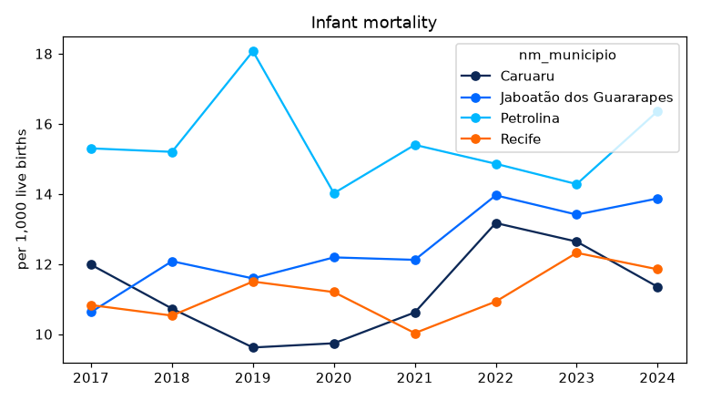
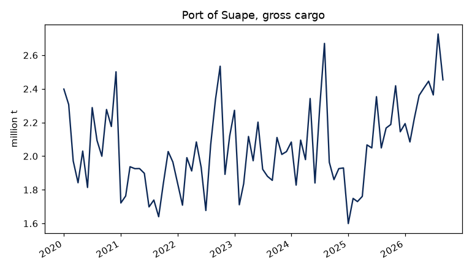

# Worked examples

Plots use matplotlib, which is not a dependency of the package
(`pip install matplotlib`).

## Infant mortality in the largest cities

Deaths under one year per thousand live births, by municipality of
residence, for Recife, Jaboatão dos Guararapes, Caruaru and Petrolina:

```python
cidades = ["2611606", "2607901", "2604106", "2611101"]

tmi = condepe.condepe_series(
    "datasus_mortalidade_infantil",
    "Taxa de mortalidade infantil (por mil nascidos vivos)",
    code=cidades,
)

largo = tmi.pivot(index="ano", columns="nm_municipio", values="valor")

largo
```

```text
nm_municipio  Caruaru  Jaboatão dos Guararapes  Petrolina  Recife
ano                                                              
2017            11.98                    10.63      15.30   10.83
2018            10.73                    12.08      15.20   10.53
2019             9.62                    11.59      18.07   11.50
2020             9.74                    12.19      14.02   11.20
2021            10.62                    12.12      15.40   10.03
2022            13.17                    13.96      14.86   10.93
2023            12.64                    13.41      14.28   12.32
2024            11.35                    13.87      16.36   11.85
```


```python
ax = largo.plot(
    marker="o",
    color=["#0c2856", "#0068ff", "#00b7ff", "#ff6700"],
    figsize=(7, 4),
    title="Infant mortality",
)

ax.set_xlabel("")

ax.set_ylabel("per 1,000 live births")

print(fig("tmi"))
```



## Cargo at the port of Suape

Monthly gross cargo handled at Suape (Ipojuca), in million tonnes:

```python
suape = condepe.condepe_series("porto_suape_carga", "Porto de Suape - Carga bruta total")

suape["data"] = pd.to_datetime(dict(year=suape["ano"], month=suape["mes"], day=1))

ax = (suape.set_index("data")["valor"] / 1e6).plot(
    color="#0c2856", figsize=(7, 4), title="Port of Suape, gross cargo"
)

ax.set_xlabel("")

ax.set_ylabel("million t")

print(fig("suape"))
```



## IDEB of the municipal schools

The Basic Education Development Index of the early years of elementary
school, municipal network, in Recife:

```python
ideb = condepe.condepe_series(
    "inep_ideb_anos_iniciais", "IDEB observado - Municipal", code="2611606"
)

ideb[["ano", "valor"]]
```

```text
     ano  valor
0   2005    3.2
1   2007    3.8
2   2009    4.1
3   2011    4.1
4   2013    4.2
5   2015    4.6
6   2017    5.0
7   2019    5.2
8   2021    5.3
9   2023    5.5
10  2025    5.8
```

## All municipalities in one year

Live births by municipality of residence in 2024, the ten largest:

```python
nasc = condepe.condepe_series("datasus_sinasc", "Nascidos vivos por residência - Total", years=2024)

nasc.nlargest(10, "valor")[["nm_municipio", "valor"]]
```

```text
                nm_municipio    valor
131                   Recife  16116.0
87   Jaboatão dos Guararapes   7284.0
125                Petrolina   6175.0
44                   Caruaru   5285.0
110                   Olinda   3879.0
121                 Paulista   3284.0
30   Cabo de Santo Agostinho   2435.0
66                 Garanhuns   1965.0
36                Camaragibe   1711.0
183   Vitória de Santo Antão   1622.0
```
