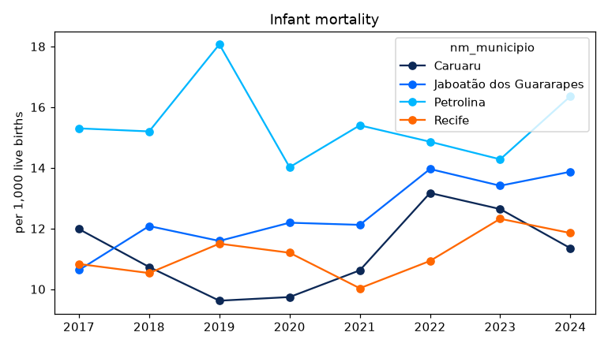
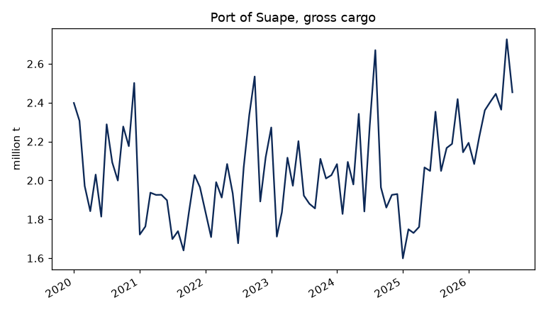
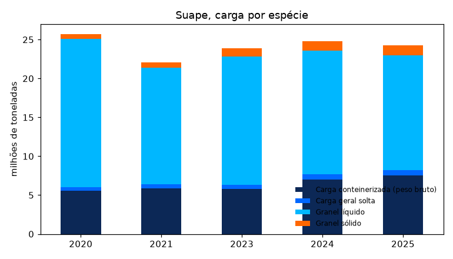

# Exemplos

Os gráficos usam o matplotlib, que não é dependência do pacote
(`pip install matplotlib`). As cores são as do Observatório: o azul
institucional de Pernambuco e os acentos da paleta oficial.

## Mortalidade infantil nas maiores cidades

Óbitos de menores de um ano por mil nascidos vivos, por município de
residência:

```python
cidades = ["2611606", "2607901", "2604106", "2611101"]

tmi = condepe.condepe_series(
    "datasus_mortalidade_infantil",
    "Taxa de mortalidade infantil (por mil nascidos vivos)",
    code=cidades,
)

largo = tmi.pivot(index="ano", columns="nm_municipio", values="valor")

largo
```

```text
nm_municipio  Caruaru  Jaboatão dos Guararapes  Petrolina  Recife
ano                                                              
2017            11.98                    10.63      15.30   10.83
2018            10.73                    12.08      15.20   10.53
2019             9.62                    11.59      18.07   11.50
2020             9.74                    12.19      14.02   11.20
2021            10.62                    12.12      15.40   10.03
2022            13.17                    13.96      14.86   10.93
2023            12.64                    13.41      14.28   12.32
2024            11.35                    13.87      16.36   11.85
```

```python
ax = largo.plot(marker="o", color=['#0c2856', '#0068ff', '#00b7ff', '#ff6700'], figsize=(7, 4),
                title="Mortalidade infantil")

ax.set_xlabel("")

ax.set_ylabel("por mil nascidos vivos")

ax.legend(title=None, frameon=False)

print(fig("tmi"))
```



## Carga movimentada no Porto de Suape

Carga bruta mensal em Suape (Ipojuca), em milhões de toneladas. Janeiro
de 2022 não foi publicado pelo porto e aparece como lacuna:

```python
suape = condepe.condepe_series("porto_suape_carga", "Porto de Suape - Carga bruta total")

suape["data"] = pd.to_datetime(dict(year=suape["ano"], month=suape["mes"], day=1))

serie = suape.set_index("data")["valor"].asfreq("MS") / 1e6

ax = serie.plot(color="#0c2856", figsize=(7, 4), title="Porto de Suape, carga bruta")

ax.set_xlabel("")

ax.set_ylabel("milhões de toneladas")

print(fig("suape"))
```



Carga por espécie em cada ano com os 12 meses publicados (2022, sem
janeiro, e o ano corrente ficam de fora):

```python
especies = ["Granel líquido", "Granel sólido",
            "Carga conteinerizada (peso bruto)", "Carga geral solta"]

d = condepe.condepe_series("porto_suape_carga",
                           ["Porto de Suape - " + e for e in especies])

meses = d.groupby("ano")["mes"].nunique()

d = d[d["ano"].isin(meses[meses == 12].index)]

anual = d.pivot_table(index="ano", columns="indicador_base", values="valor",
                      aggfunc="sum") / 1e6

anual.columns = [c.replace("Porto de Suape - ", "") for c in anual.columns]

ax = anual.plot.bar(stacked=True, color=['#0c2856', '#0068ff', '#00b7ff', '#ff6700'], figsize=(7, 4),
                    title="Suape, carga por espécie", rot=0)

ax.set_xlabel("")

ax.set_ylabel("milhões de toneladas")

ax.legend(frameon=False, fontsize=8)

print(fig("suape_especies"))
```



## IDEB das escolas municipais

O Índice de Desenvolvimento da Educação Básica dos anos iniciais do
ensino fundamental, rede municipal, no Recife:

```python
ideb = condepe.condepe_series(
    "inep_ideb_anos_iniciais", "IDEB observado - Municipal", code="2611606"
)

ideb[["ano", "valor"]]
```

```text
     ano  valor
0   2005    3.2
1   2007    3.8
2   2009    4.1
3   2011    4.1
4   2013    4.2
5   2015    4.6
6   2017    5.0
7   2019    5.2
8   2021    5.3
9   2023    5.5
10  2025    5.8
```

## Todos os municípios num ano

Nascidos vivos por município de residência em 2024, os dez maiores, e
a proporção de partos cesáreos, cruzando dois indicadores da mesma
fonte:

```python
total = "Nascidos vivos por residência - Total"

cesareo = "Nascidos vivos por residência - Parto cesáreo"

d = condepe.condepe_series("datasus_sinasc", [total, cesareo], years=2024)

w = d.pivot(index="nm_municipio", columns="indicador_base", values="valor")

w["pct_cesareo"] = 100 * w[cesareo] / w[total]

w.nlargest(10, total).round(1)
```

```text
indicador_base           Nascidos vivos por residência - Parto cesáreo  \
nm_municipio                                                             
Recife                                                          7988.0   
Jaboatão dos Guararapes                                         3595.0   
Petrolina                                                       3170.0   
Caruaru                                                         3342.0   
Olinda                                                          1732.0   
Paulista                                                        1712.0   
Cabo de Santo Agostinho                                         1278.0   
Garanhuns                                                       1174.0   
Camaragibe                                                       795.0   
Vitória de Santo Antão                                          1050.0   

indicador_base           Nascidos vivos por residência - Total  pct_cesareo  
nm_municipio                                                                 
Recife                                                 16116.0         49.6  
Jaboatão dos Guararapes                                 7284.0         49.4  
Petrolina                                               6175.0         51.3  
Caruaru                                                 5285.0         63.2  
Olinda                                                  3879.0         44.7  
Paulista                                                3284.0         52.1  
Cabo de Santo Agostinho                                 2435.0         52.5  
Garanhuns                                               1965.0         59.7  
Camaragibe                                              1711.0         46.5  
Vitória de Santo Antão                                  1622.0         64.7
```
