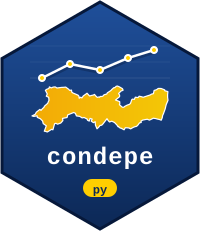

# condepe 

Python access to the open data of the **Observatório de Pernambuco**, published by
[Condepe/Fidem](https://cf.pe.gov.br) (the Pernambuco State Agency for Planning and
Research): municipal series on population, economy, public finance, labour,
education, health, security, transport and environment for the 185
municipalities of Pernambuco, Brazil.

Every source is published in the same long format (one observation per row, 15
columns), so one set of functions covers all of them.

## Installation

```bash
pip install condepe
# development version:
pip install git+https://github.com/StrategicProjects/condepe-py
```

## Usage

```python
import condepe

# Sources available (one row each), with the catalogue version
cat = condepe.condepe_catalog()
cat.attrs["version"]

# Indicators of a source
condepe.condepe_indicators("sidra_populacao_estimada")

# A series: Recife (IBGE 2611606), 2020 onwards
condepe.condepe_series(
    "sidra_populacao_estimada",
    "Populacao residente estimada",
    code="2611606",
    years=range(2020, 2027),
)

# A whole source, and the municipality list
condepe.condepe_data("datasus_sinasc")
condepe.condepe_localities()
```

Column names are kept in Portuguese, as published, so results stay traceable to
the official files: `cd_municipio_ibge`, `nm_municipio`, `ano`, `mes`,
`indicador`, `indicador_base`, `valor`, `unidade`, `natureza`, `id_fonte`,
`eixo`, `tema`, `assunto`, `fonte_original`, `arquivo_origem`. Monthly series
carry the period in `indicador` (`"… [MM/YYYY]"`) and `mes`; `indicador_base` is
the label without it.

## Where the data come from

- **Canonical:** <https://cf.pe.gov.br/observatorio/dados/atual/>
- **Mirror (fallback):** the Hugging Face dataset
  [`mlkwy/observatorio-pernambuco`](https://huggingface.co/datasets/mlkwy/observatorio-pernambuco),
  with the same relative paths.

Files are cached on disk per catalogue version (`condepe_cache_dir()`) and
checked against the sha256 published in the catalogue. The catalogue itself is
trusted for 6 hours. Set `CONDEPE_URL`, `CONDEPE_MIRROR_URL` or
`CONDEPE_CACHE_DIR` to override the defaults.

## Citation and license

Data: Condepe/Fidem, *Observatório de Pernambuco — Base de Dados do Estado*,
[CC BY 4.0](https://creativecommons.org/licenses/by/4.0/). The citation with the
version in use is in `condepe_catalog().attrs["citation"]`.

Code: MIT. To read or write *private* buckets on `s3.pe.gov.br` with an
access key, see [`s3pe`](https://github.com/StrategicProjects/s3pe); `condepe`
needs no key, since the Observatory open data are public. An R package with the same functions is
[`condepe` for R](https://github.com/StrategicProjects/condepe-r).
