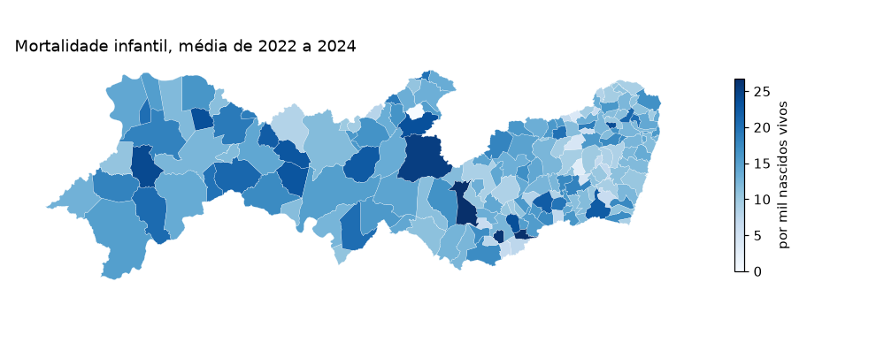
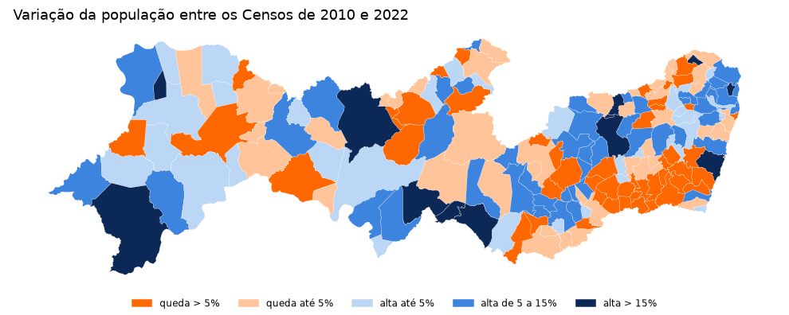
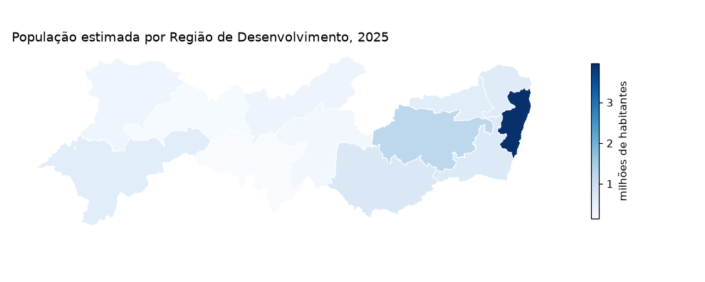
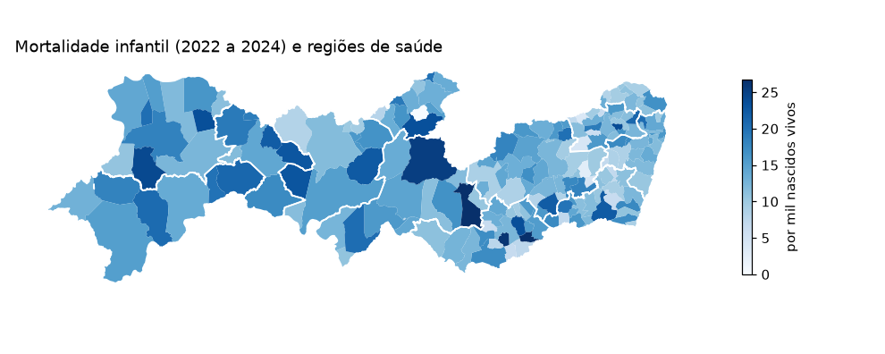
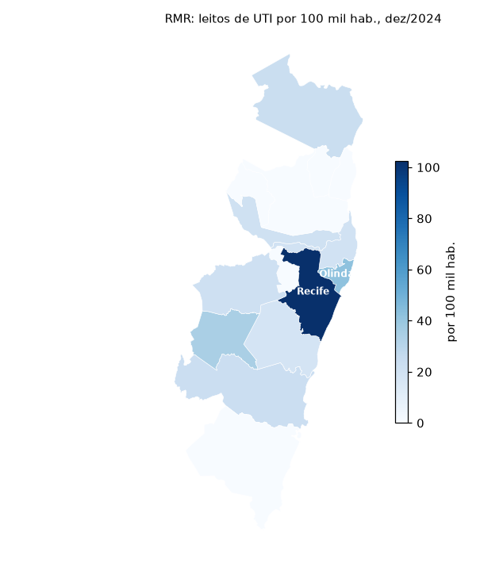

# Mapas

Toda observação do Observatório traz o código IBGE do município
(`cd_municipio_ibge`), e isso basta para juntar os dados a uma malha
municipal e fazer mapas. O pacote traz a malha (`condepe_geometry()`),
a junção (`condepe_add_geometry()`) e as regionalizações do estado
(`condepe_regions()`). As funções de malha usam `geopandas`, que é
opcional; os gráficos usam `matplotlib`:

```bash
pip install "condepe[geo]" matplotlib
```

## A malha municipal

`condepe_geometry()` baixa a Malha Municipal de Pernambuco publicada
pela Condepe/Fidem (a edição corrente, conferida pelo SHA-256 e
guardada em cache). Com `source="ibge"`, a malha vem da API de malhas
do IBGE. Fernando de Noronha (2605459) fica a 545 km da costa e, num
mapa do estado inteiro, espreme o continente para a esquerda; os mapas
abaixo o deixam de fora com `noronha=False`:

```python
malha = condepe.condepe_geometry(noronha=False)

print(len(malha), "municípios; edição", malha.attrs["version"], ";", malha.crs)

malha.head(3)
```

```text
184 municípios; edição 2025-v3 ; EPSG:4326
  cd_municipio_ibge           nm_municipio                                         geometry
0           2600054           Abreu e Lima  POLYGON ((-34.9148 -7.9276, -34.91576 -7.927...
1           2600104  Afogados da Ingazeira  POLYGON ((-37.52795 -7.73721, -37.52758 -7.7...
2           2600203                Afrânio  POLYGON ((-40.76417 -8.62047, -40.76398 -8.6...
```

## Mortalidade infantil

A taxa é ruidosa nos municípios pequenos (poucos nascimentos por ano);
a média de três anos é mais estável:

```python
tmi = condepe.condepe_series(
    "datasus_mortalidade_infantil",
    "Taxa de mortalidade infantil (por mil nascidos vivos)",
    years=[2022, 2023, 2024],
)

media = tmi.groupby("cd_municipio_ibge", as_index=False)["valor"].mean()

mapa = condepe.condepe_add_geometry(media, geometry=malha)

ax = mapa.plot(column="valor", cmap="Blues", edgecolor="white", linewidth=0.15,
               legend=True, figsize=(9, 3.6),
               legend_kwds={"label": "por mil nascidos vivos", "shrink": 0.6},
               missing_kwds={"color": "lightgrey"})

ax.set_axis_off()

ax.set_title("Mortalidade infantil, média de 2022 a 2024", loc="left")

print(fig("mapa_tmi"))
```



## Variação da população entre os Censos

Para uma variação, que tem sinal, classes com cores divergentes deixam
claro quem cresceu e quem encolheu. População dos Censos de 2010 e
2022 (as estimativas anuais não cobrem anos de Censo):

```python
pop = condepe.condepe_series(
    "sidra_censo_cor_raca", "IBGE - População residente - Total", years=[2010, 2022]
)

w = pop.pivot(index="cd_municipio_ibge", columns="ano", values="valor")

w["var"] = 100 * (w[2022] / w[2010] - 1)

rotulos = ["queda > 5%", "queda até 5%", "alta até 5%", "alta de 5 a 15%", "alta > 15%"]

w["classe"] = pd.cut(w["var"], [-1e9, -5, 0, 5, 15, 1e9], labels=rotulos)

mapa = condepe.condepe_add_geometry(w.reset_index(), geometry=malha)

cores = dict(zip(rotulos, ["#ff6700", "#ffc49a", "#bcd6f5", "#3d84df", "#0c2856"]))

ax = mapa.plot(color=mapa["classe"].map(cores).astype(str), edgecolor="white",
               linewidth=0.15, figsize=(9, 3.6))

from matplotlib.patches import Patch

ax.legend(handles=[Patch(color=c, label=r) for r, c in cores.items()],
          loc="lower center", ncol=5, frameon=False, fontsize=8,
          bbox_to_anchor=(0.5, -0.12))

ax.set_axis_off()

ax.set_title("Variação da população entre os Censos de 2010 e 2022", loc="left")

print(fig("mapa_populacao"))

mapa["classe"].value_counts().sort_index()
```

```text
classe
queda > 5%         48
queda até 5%       43
alta até 5%        34
alta de 5 a 15%    47
alta > 15%         12
Name: count, dtype: int64
```



## Regiões

        `condepe_regions()` diz a que região pertence cada município em doze
        regionalizações: Regiões de Desenvolvimento (RD) da Condepe/Fidem,
        meso e microrregiões e regiões imediatas e intermediárias do IBGE,
        regiões e macrorregiões de saúde, Gerências Regionais de Educação
        (GRE), regiões fiscais da SEFAZ, Diretorias Regionais de Operações (DRO) do DER e regiões
metropolitanas. A tabela é
        publicada pelo Observatório junto com os dados abertos
        (`referencia/regioes.parquet`) e lida de lá com cache, como as fontes;
        sem rede, vale a cópia que vai com o pacote (`offline=True` força essa):

```python
reg = condepe.condepe_regions()

reg["rd"].value_counts()
```

```text
rd
Agreste Central                   27
Agreste Meridional                26
Mata Sul                          23
Mata Norte                        19
Agreste Setentrional              19
Sertão do Pajeú                   17
Região Metropolitana do Recife    14
Sertão do Araripe                 10
Sertão Central                     8
Sertão do São Francisco            7
Sertão do Moxotó                   7
Sertão de Itaparica                7
Distrito Estadual                  1
Name: count, dtype: int64
```

Para mapear uma região, agregue os dados numa coluna `regiao` e passe
`level` a `condepe_add_geometry()`: a malha municipal é dissolvida na
regionalização pedida, com as mesmas divisas. População estimada de
2025 por Região de Desenvolvimento:

```python
pop = condepe.condepe_series("sidra_populacao_estimada",
                             "Populacao residente estimada", years=2025)

pop = pop.merge(condepe.condepe_regions("rd")[["cd_municipio_ibge", "regiao"]])

por_rd = pop.groupby("regiao", as_index=False)["valor"].sum()

mapa = condepe.condepe_add_geometry(por_rd, level="rd", noronha=False)

ax = mapa.plot(column=mapa["valor"] / 1e6, cmap="Blues", edgecolor="white",
               linewidth=0.6, legend=True, figsize=(9, 3.6),
               legend_kwds={"label": "milhões de habitantes", "shrink": 0.6})

ax.set_axis_off()

ax.set_title("População estimada por Região de Desenvolvimento, 2025", loc="left")

print(fig("mapa_rd"))

por_rd.sort_values("valor", ascending=False)
```

```text
                            regiao      valor
6   Região Metropolitana do Recife  3961730.0
0                  Agreste Central  1214544.0
1               Agreste Meridional   702044.0
5                         Mata Sul   671469.0
4                       Mata Norte   610969.0
12         Sertão do São Francisco   569327.0
2             Agreste Setentrional   567121.0
11                 Sertão do Pajeú   345392.0
9                Sertão do Araripe   336359.0
10                Sertão do Moxotó   251957.0
7                   Sertão Central   184722.0
8              Sertão de Itaparica   143032.0
3                Distrito Estadual     3341.0
```



Os contornos das regiões também servem de camada sobre um mapa
municipal: a mortalidade infantil por município e, por cima, as doze
regiões de saúde (as Geres):

```python
geres = condepe.condepe_geometry("regiao_saude", noronha=False)

ax = condepe.condepe_add_geometry(media, geometry=malha).plot(
    column="valor", cmap="Blues", legend=True, figsize=(9, 3.6),
    legend_kwds={"label": "por mil nascidos vivos", "shrink": 0.6},
    missing_kwds={"color": "lightgrey"})

geres.boundary.plot(ax=ax, color="white", linewidth=1.1)

ax.set_axis_off()

ax.set_title("Mortalidade infantil (2022 a 2024) e regiões de saúde", loc="left")

print(fig("mapa_saude"))
```



## Região Metropolitana do Recife

Para ver um recorte, filtre a malha antes de desenhar. Os 15
municípios da RMR (Goiana entrou em 2018) e os leitos de UTI por 100
mil habitantes em dezembro de 2024; município sem leito no CNES conta
como zero leitos de UTI:

```python
reg_rm = condepe.condepe_regions("rm")

rmr = reg_rm.loc[reg_rm["regiao"] == "Região Metropolitana do Recife",
                 "cd_municipio_ibge"].tolist()

uti = condepe.condepe_series("datasus_leitos", "Leitos de UTI - Total",
                             code=rmr, years=2024)

pop = condepe.condepe_series("sidra_populacao_estimada", "Populacao residente estimada",
                             code=rmr, years=2024)

d = pop[["cd_municipio_ibge", "nm_municipio", "valor"]].merge(
    uti[["cd_municipio_ibge", "valor"]], on="cd_municipio_ibge",
    how="left", suffixes=("_pop", "_uti")).fillna({"valor_uti": 0})

d["por_100mil"] = 1e5 * d["valor_uti"] / d["valor_pop"]

mapa = condepe.condepe_add_geometry(d, geometry=malha, how="inner")

ax = mapa.plot(column="por_100mil", cmap="Blues", edgecolor="white", linewidth=0.4,
               legend=True, figsize=(5.5, 6.5),
               legend_kwds={"label": "por 100 mil hab.", "shrink": 0.5})

for _, r in mapa[mapa["por_100mil"] >= 40].iterrows():  # nm_municipio vem da malha
    p = r.geometry.representative_point()
    ax.annotate(r["nm_municipio"], (p.x, p.y), ha="center", fontsize=8,
                color="white", weight="bold")

ax.set_axis_off()

ax.set_title("RMR: leitos de UTI por 100 mil hab., dez/2024", loc="left", fontsize=10)

print(fig("mapa_rmr"))

d.sort_values("por_100mil", ascending=False)[["nm_municipio", "valor_uti", "por_100mil"]].round(1)
```

```text
               nm_municipio  valor_uti  por_100mil
13                   Recife     1627.0       102.5
11                   Olinda      155.0        42.4
10                   Moreno       20.0        34.7
4                    Goiana       20.0        23.5
2   Cabo de Santo Agostinho       50.0        23.0
14     São Lourenço da Mata       25.0        21.2
0              Abreu e Lima       22.0        21.2
12                 Paulista       72.0        19.8
9   Jaboatão dos Guararapes      124.0        18.1
1                 Araçoiaba        0.0         0.0
3                Camaragibe        0.0         0.0
5                  Igarassu        0.0         0.0
6                   Ipojuca        0.0         0.0
7         Ilha de Itamaracá        0.0         0.0
8                Itapissuma        0.0         0.0
```



Os leitos concentram-se no Recife, que atende pacientes de toda a
região: o indicador mede oferta no município, não acesso de quem mora
nele.
